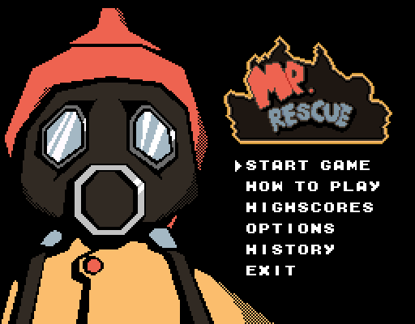
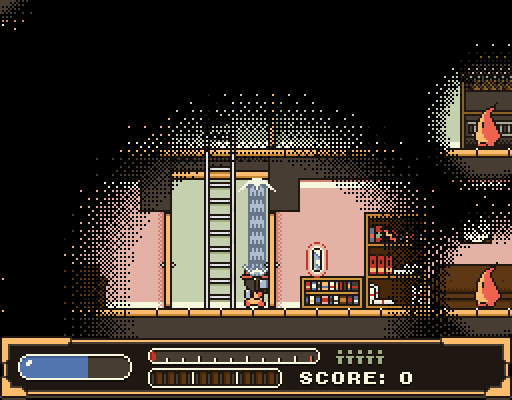

# Mr. Rescue for Miyoo Mini Plus

An **unofficial** OnionOS port of [Mr. Rescue](https://github.com/SimonLarsen/mrrescue),
the arcade firefighting game by Tangram Games, for the Miyoo Mini Plus.

 

The game's Lua code runs **unmodified**. The handheld has no GPU, so the port
replaces LÖVE's OpenGL drawing with `mini2d`, a small CPU renderer that draws
at the game's native 256×200 and lets the SoC's 2D blitter scale the frame
to the screen. Built on the runtime from
[panelattack-miyoo](https://github.com/snyderman3000/panelattack-miyoo).

## Install

Copy the `Roms` folder from the release zip to the root of the SD card (or
install from [Mixtape](https://github.com/snyderman3000/mixtape)), then launch
**Mr. Rescue** from Games › Ports › Platform.

## Controls

| Button | Playing | Menus |
|---|---|---|
| D-pad | Move, climb ladders, aim (Up/Down + shoot) | Move |
| B | Jump | Back |
| A | Grab / throw | OK |
| Y, X, L1, R1 | Shoot water | |
| Start | Pause | Pause / OK |
| Select | Pause menu | Back |
| Select + Start | Quit | Quit |

**Options › Screen:** SHARP (2× pixels, small border), FIT (full height,
correct proportions) or STRETCH (whole screen).

## How it works

| Path | Purpose |
|---|---|
| `mini2d/mini2d.c` | CPU renderer: blits with alpha/add/multiply blending, an affine blit for rotated and repeating sprites, and presenting through the MI_GFX blitter with selectable scaling |
| `overlay/miyoo/graphics.lua` | `love.graphics` on top of mini2d (images, canvases, quads, image fonts) |
| `overlay/miyoo/shim.lua` | Window stubs, buttons → keyboard + virtual gamepad, audio through OnionOS |
| `overlay/miyoo/patches.lua` | Runtime tweaks: 1× rendering, screen modes, handheld Options screen |
| `build_game.sh`, `build_pkg.sh` | Build the game folder and the release zip |
| `tools/` | Headless desktop test harness (scripted input, frame dumps), audio conversion |

See [docs/BUILDING.md](docs/BUILDING.md).

## Credits

- **Mr. Rescue** by Tangram Games: code zlib, graphics/music/text CC BY-SA 3.0.
- **LÖVE** 11.5 (zlib), **LuaJIT** (MIT), **steward-fu**'s Miyoo Mini toolchain and SDL2.
- **OS:** [OnionOS](https://github.com/OnionUI/Onion).
- **Port code, renderer and docs:** written by Claude (Anthropic).

## License

The port code is MIT licensed ([LICENSE](LICENSE)). The release zip bundles
Mr. Rescue, LÖVE and libraries under their own licenses, listed in
[THIRD_PARTY_NOTICES.md](THIRD_PARTY_NOTICES.md).
